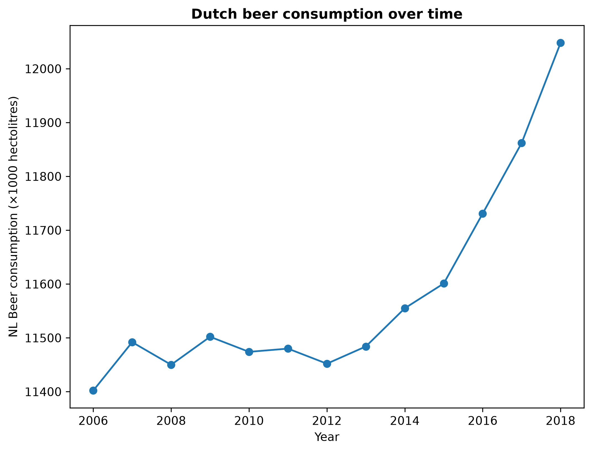

# Student ID
17067308
# Title of MCC Van Dyke et al., 2019
Fantastic yeasts and where to find them: the hidden diversity of dimorphic fungal pathogens
# Title of JT Harvey, Applied Ergonomics, 2002
An analysis of the forces required to drag sheep over various surfaces
# Title of DW Ziegler et al., 2005
Implantation markers and endometriosis
# Plot

The plot shows the beer consumption in the Netherlands (measured in hectolitres) over time. There is data from 2008, 2010, 2012, 2014 and 2016. It could be seen that the beer consumption between 2008 and 2013 is relatively steady, namely between 11400 and 11500 hectolitres. The beer consumption is from 2014 increasing. Especially from 2015, because the beer consumption is increasing by almost 200 every year.  
